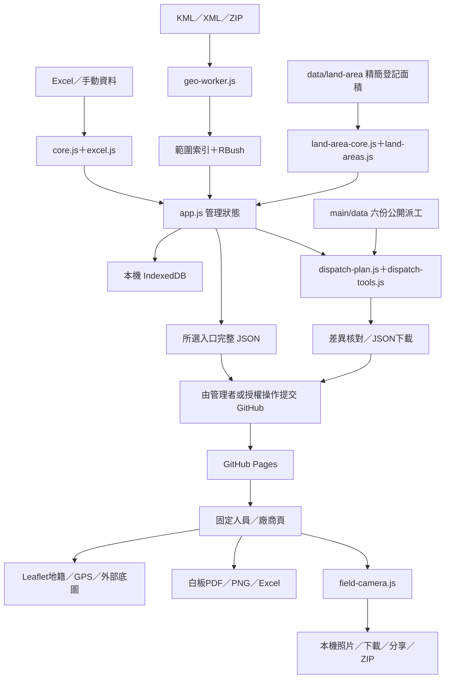

# photosheet 規格書

文件整理日：2026-11-20（Asia/Taipei）。既有派工／公開資料基準：`8258a4226ab3f62e10c0d1ebdcd83f58f631161f`。此為目前可查證規格，不把早期構想當成現行功能。P0版（起點`2d0b13c`）僅修測試／文件，見[ADR-0014](adr/0014-clock-consistent-browser-gps-fixtures.md)。本次在`7a1b75c`上加入管理月統計，見[ADR-0015](adr/0015-admin-monthly-statistics.md)，未變更公開派工資料。本次再以`2dc0593`為起點緊湊化管理版面，見[ADR-0016](adr/0016-compact-manager-layout.md)。測試與未決事項以 [交接紀錄](HANDOFF.md) 為準，決策沿革見 [ADR](adr/README.md)。

## 1. 目標、界線與角色

在 GitHub Pages 運作的靜態地籍派工工具。管理者整理案件、配對範圍、分派、產生文件及發布；現場端盡量少操作，直接讀取固定網址的派工包。

| 入口 | 資料身分 | 主要功能與限制 |
|---|---|---|
| `index.html` | 本機 manager | Excel／手動任務、地籍、面積、指派、完成、發布、備份 |
| `worker-1/2/3.html` | p1／p2／p3 | 固定派工清單、搜尋／篩選、地圖／GPS／導航、詳情白板與拍照 |
| `vendor-1/2/3.html` | v1 雜草垃圾／v2 砍樹／v3 圍籬 | 同類現場操作，固定類型不能混入別類，照片不計完成張數 |
| `photosheet-app.html` | 舊照片排版工具 | 保留，非目前派工架構的等價入口 |

無遠端 API、遠端資料庫、登入／裝置綁定／OTP、自動認領、照片回傳或即時多端同步。先前「至少兩張」是作業需求；現行現場頁顯示人員張數但不強制最低張數，也沒有伺服器完成判定。後端版 `land-dispatch-hub` 與照片編排器 CW015 不在本規格的交付範圍。

## 2. 架構、層級與資料流

- `core.js`：正規化、日期、任務、派工規則、KML/XML parser、索引與幾何。
- `app.js`：管理／現場畫面、持久狀態、入口、匯入及完整快照發布。
- `db.js`：IndexedDB `photosheet-static-v1`，version 2；state／geo／photos 三個 object store，照片以 person＋taskId 索引。
- `geo-worker.js`：背景解壓／解析，避免把完整地籍匯入放在主 UI 執行緒。範圍每1000筆分片儲存；還原 state＋geo 使用同一交易。
- `dispatch-plan.js` 是無網路／儲存的純規劃器；`dispatch-tools.js` 為獨立發布工作區。
- `manual-tasks.js` 為手動表單；`whiteboard.js` 為白板直接輸出；`documents.js` 與 `field-camera.js` 為文件／現場照片；管理端 `camera.js` 保留獨立行為，不套用現場相機所有規則。
- 派工頁相依隨 `vendor/` 發布；舊photosheet-app保留原外部相依，不把它泛稱零CDN。圖磚與線上資料請求是外部互動，非後端。

## 3. 任務與匯入需求

**R-01 一案多地號**：Excel 一行一任務，以 task.id 識別；serial／案號不是唯一鍵。不得按地號拆案、重算工作數量，亦不得因地號相同就合併不同工作類型或案件。

**R-02 Excel**：支援砍樹、圍籬、雜草垃圾工作表及「段」對照；可勾匯入類型、逐筆或統一修改成果日。公式只讀快取值，不執行公式。成果日初值取「通知」；期限取「完成」日期搭配臺灣時間17:00，匯入需核對。重匯保留已有人工分派等保護欄位，不覆蓋 manual 任務。

**R-03 手動任務**：可填類型、案號、成果日、期限、人員、多地段地號、四碼段代號、工作項目／數量、廠商／人員、選填導航。ID 以 `manual:` 開頭；可修正／新增地號，保留 originalParcels；拒絕空白、非法及重複地號。跨段時不能沿用不相符的舊代碼。

**R-04 刪除**：只有 `source=manual` 或 manual: ID 的管理者建立任務可刪；空白 serial 的 Excel 任務不因此可刪。需確認、寫入失敗回復；共用地籍與裝置照片保留。已公開派工需另在發布工作區移除並重新發布，本機刪除不改 GitHub。

## 4. 日期、顯示、指派與完成

**R-05 日期語意**：`resultDate` 是成果照片必須顯示的日期，不是實際拍攝日；`due` 是期限。浮水印時分秒使用按快門時的 Asia/Taipei 時間。不得將三者混用。

**R-06 管理清單**：預設只顯示今年本月1日至今年12月31日的有效成果日任務；其他年份、舊月及缺日期仍留在資料與備份。已手動加回的任務保留顯示。清單篩選、既有摘要與批次操作以可見範圍為準；新增月統計依R-26獨立計算，現場派工包不受管理頁顯示篩選自動刪除。

**R-07 舊案**：上月以前未指派案不可新增指派，已指派案鎖原人；解除後不可藉改日期重新派。程式以 assignmentClosed／assignmentLockedTo 表達舊案規則，**不保證全部舊案都寫成 completed=true**。這是本機流程保護，不能阻止刻意改 JSON。

**R-08 加回**：「搜尋上個月任務」僅找目前本機資料中的前一個日曆月，支援跨年與閏月、每頁20筆。加回會設定 reopenedForDispatch／reopenedAt、清完成與舊案鎖，保留原成果日、地號與導航，重新開放人員指派及按類型廠商發布。不是只恢復畫面；重載與備份仍保留。

**R-09 完成**：管理者可單筆／批次標記及取消完成；完成案不得直接新增／改派，要先取消完成。發布排除完成案；可產生空清單移除舊派工。照片本機張數不自動寫 completed，也不會同步到管理裝置。

**R-10 自動指派**：屏東市、九如鄉、里港鄉、高樹鄉、鹽埔鄉、長治鄉、麟洛鄉、內埔鄉、三地門鄉、霧台鄉、瑪家鄉給 p1，其餘已知鄉鎮給 p2。保留 p3、完成／鎖定／不可見案；缺鄉鎮不猜。跨鄉鎮以主要鄉鎮處理，一案不拆。v1/v2/v3 依工作類型分組，不改 p1/p2/p3。

**R-26 管理月統計**：管理頁顯示本月／上個日曆月的民國年月，依本機全部任務的有效成果日期（resultDate）分月，含已完成、未指派、隱藏舊案及加回任務。三類雜草垃圾／砍樹／圍籬與合計，各顯示案件件數、地號筆數。一任務一件；地號按目前parcels逐案累加，同地號跨案分別計筆，非全月唯一土地數。零資料顯示0，缺漏／無效成果日期不計。統計不受清單搜尋／類型／人員／完成／日期篩選或分頁影響，切換不改任務、不重新開放舊案。

匯入、還原、新增、刪除、修改成果日期／地號等管理更新後即重算；以Asia/Taipei判定本月，跨年正確。回到前景／視窗聚焦時檢查月界，持續前景每分鐘檢查一次；跨月保留相對本月／上月選項，重載預設本月。僅管理頁載入，無遠端同步，資料來源限本機已匯入案件。詳見[ADR-0015](adr/0015-admin-monthly-statistics.md)。

## 5. 地籍、面積、地圖與導航

**R-11 正規化與範圍**：四碼代號保留前導零（582→0582），地號正規化（0001-0002→1-2）；鍵至少含縣市＋段代號＋地號／唯一地段對照。KML 的 SECTNO／PARCELNO 或名稱0582/1198均可配；無XML也可依代碼配對。對照衝突不能任取第一筆；多段任務逐段解析。MultiPolygon、孔洞、不同圖幅片段合併，同片段去重。

**R-12 座標**：KML／內部 point 均為 WGS84 `[經度,緯度]`，Leaflet LatLng 呼叫需換序。禁止把投影公尺直接當經緯度或以別筆圖形替補。中心參考點用於地圖／導航建議，不保證可通行入口。管理清單／詳情不顯示配對成功失敗徽章或配對統計，資料錯誤提醒與地圖仍保留。

**R-13 導航權限界線**：管理頁可點圖、拖圖釘、輸入座標核對入口；不得因現場簡化誤刪管理操作。人員與廠商的地圖主工具列不提供「點圖設定本機入口」按鈕；人員詳情仍有「改在地圖設定」，也可拖導航圖釘並存本機 override，廠商無點圖按鈕且圖釘不可拖。現行 app.js 的現場詳情另提供座標編輯，可保存裝置入口；不能把它說成會更新管理端。override 以入口及 batch 保存，同 batch 重載沿用，新 batch 依發布入口。導航用 Google Maps 官方 URL，無 API key。

**R-14 XML 登記面積**：原 XML 不公開，使用本機轉換的 `data/land-area/catalog.json` 及每地段精簡 JSON，按需取檔而非全載。資料快照907段、182,597筆不同地號。只保留地籍鍵／登記面積／問題標記，無權利人、統編或持分。四碼XML段代號在詳情與面積預覽可查。

面積按不同地號去重、最多六位小數精確相加；完整才能套總面積，缺漏／衝突只顯示小計，0有效且不能拿缺值當0。保留 originalArea 與 landArea 明細／簽章／核對時間；改地號使推算面積失效。工作項目數量不改，KML 形狀面積不冒充登記面積。詳見[面積文件](land-area.md)。

**R-15 圖層**：所有現行地籍範圍為1.5px紅框 #ff0000＋橘填色 #ff9800／25%透明度。現場一般圖為OSM、正射為NLSC PHOTO2；管理另加農村水保署屏東局部UAV，故障依UAV→NLSC→OSM備援。保留來源及影像非即時提示，偏好管理／現場分開。只載目前視野瓦片，不預抓整縣。

管理頁桌面為清單／地圖雙欄，980px以下以清單／地圖頁籤操作；每頁25筆。搜尋與類型、人員、完成篩選及批次操作保留，不套現場地圖貼邊。

管理首頁採緊湊版面：1100px以上工具與月統計並排，較窄視窗直排；980px以下工具四欄、發布兩鈕各跨兩欄，手機控制最小44px高，桌面一般控制最小36px高。類型／人員／完成及可展開的日期篩選整合一列（窄螢幕換行、日期展開時獨佔整列），縮短頁首、面板、表格與任務列間距。移除品牌副標及首頁操作教學、月統計長說明、廠商JSON與地圖靜態說明，短文案保留清單範圍與隱藏數。所有功能、成果月份、件／筆單位、任務／地號資料保留；發布與刪除確認、錯誤／進度、圖資來源／日期／備援等操作當下訊息保留。只載入管理專用CSS，不改現場相機／地圖／照片布局。詳見[ADR-0016](adr/0016-compact-manager-layout.md)。

**R-16 現場地圖 UI**：緊湊清單每頁50筆、人員保留搜尋／篩選／選取，廠商固定類型不顯示多餘類型篩選。任務清單在前、地圖在後、注意事項最後；點任務同步選取並捲到地圖，不自動開相機。地圖有拍照、導航、重設位置與單鍵GPS；白板留在詳情。未選任務拍照停用。980px以下地圖左右貼齊視窗，控制列保留內距，無橫向溢出；桌面及管理版面不套該貼邊規則。

**R-17 手機GPS**：單鍵「定位到我／關閉定位」，藍點與精度圈、任務橘點分開。任務切換不改入口，不持續搶視野；背景暫停、前景恢復，過期點變灰。拒絕／逾時可重試，不能用任務點假扮手機點。

## 6. 白板、工作單與現場照片

**R-18 文件**：白板A4橫式，日期／地段／全案地號字盡量大，底部兩行廠商與人員，無框線及多餘標題。管理與現場詳情可出白板；直接PDF／PNG 2400×1697及Excel，批次合併PDF／圖片ZIP。工作單A4直式，圍籬為開口契約訂單通知表，其餘為工作通知單，整案量不按地號重複；工作單以列印視窗／另存PDF及Excel，不承諾原Excel逐像素還原。產生失敗要留可重試狀態，不以空白分頁當成功。

**R-19 相機**：人員／廠商使用 getUserMedia＋video；不提供 capture input 原生相機選取入口。ImageCapture.takePhoto 優先，失敗使用完整 videoWidth×videoHeight；EXIF方向正確還原。高解析度偏好、resizeMode:none，沒有強制4:3、4096上限或軟體裁圖，但不能保證與每款原生相機解析度／視野完全相同。

相機取景／拍後預覽依實際影像比例滿寬，長畫面可捲動。鏡頭／倍率與標題固定於取景上方，76×76 CSS px圓形快門獨立置於底部中央，不顯示文字但保留「拍照」無障礙名稱、鍵盤拍攝及焦點標示。600px以上橫式僅將上方鏡頭／倍率排成一列，快門仍在底部中央；兩區由取景分隔，鏡頭／倍率控制至少44px高。拍後設定區隱藏，儲存／失敗重試維持文字按鈕。移除常駐「照片保留完整尺寸…」「點選倍率切換…」，保留必要錯誤與儲存訊息；無白線框或暗罩。新呈現取代前次底部分隔線布局，見[ADR-0018](adr/0018-round-shutter-top-optics.md)。

**R-20 鏡頭**：取得授權後優先使用瀏覽器可存取的後置超廣角；不可用／失敗退回原後置鏡頭。具真正0.5×硬體能力時優先採用；排除可辨識前置。按鈕固定0.5×、0.75×、1.0×，不支援者停用；不以裁切假造0.5。手動改選及同次連拍不被自動偏好覆蓋；不能保證瀏覽器開放所有實體鏡頭。

**R-21 浮水印**：取景與成品共用繪製函式；成果指定日（民國年）＋快門當下臺灣時分秒＋GPS／精度。透明底、白字陰影，沿照片長邊；直式左側順時針90°，橫式／方形下方置中。只旋轉字，不旋轉／裁切影像。舊照片不重製。

**R-22 拍攝生命週期**：快門後立即處理並顯示含浮水印照片；有效定位5秒內可重用，超過需取新定位，與取像並行。未取得有效GPS不寫假座標。GPS／存檔失敗保留 pending 讓重試，成功前點空白不能丟圖；寫入完成後點照片或非按鈕區返回取景，再按快門拍下一張。沒有「拍攝下一張」按鈕。沿用相機串流與定位監聽減少重開，離開時釋放；重試沿用既有浮水印及識別碼。

**R-23 本機相簿**：新現場靜態照片主要保存含浮水印JPEG；不另重複保存原圖，舊 Blob／原圖資料仍相容。成果JPEG經Canvas重編碼，**不保證保留EXIF GPS**，浮水印及照片記錄gps是不同資料來源。照片不回傳；管理備份不含照片。現行人員相簿顯示本機張數，廠商不顯示完成張數；兩者都不自動完成任務。歷史要求每案至少2張，但現場頁沒有最低張數設定或強制門檻，明確2張提示仍見於管理用舊camera.js；不能寫成現場已完成此檢查。

詳情相簿以勾選／全選做ZIP與批次刪除；ZIP只含選中浮水印JPEG、原位元組不重編碼、不含其他任務／人員或原圖。單張逐列儲存／刪除按鈕移除，但拍後及放大檢視保留單張儲存。刪除先確認，IDB交易失敗整批回復；變更勾選使舊ZIP失效。分享取消不刪資料；需要再次手勢時可重試分享或直接下載。 單張JPEG（拍後／放大檢視）及ZIP使用Web Share時只傳files，不附title、text、url，避免接收端在檔案前另送標題文字；檔名與內容不變。JPEG分享失敗仍可下載；LINE實際接收呈現需實機驗證，見[ADR-0019](adr/0019-file-only-photo-sharing.md)。

## 7. 發布、差異與資料契約

**R-24 完整快照發布**：管理頁選六個入口，下載所選入口各自未壓縮JSON，排除完成案及未引用範圍；未選入口不產檔，空清單可清舊案。這個模式不合併線上資料，可能取代同名入口全部內容，必須區分於工作區追加。

**R-25 整理發布工作區**：讀取 main/data 作基準；新任務追加，重複不新增，現有欄位要逐欄勾選才改；刪除也核對。依ID去重，跨ID需工作類型＋案號＋成果日＋全部地籍相同，缺案號只認ID。相同ID矛盾資料拒絕。保留仍被其他案引用的KML，不新帶無引用範圍；未提供欄位不刪、不自動重設batch。

可同步同一任務的已核對欄位到其他入口，但原值不同不猜測，assignee不跨入口同步。匯出前重新讀線上基準，資料變動／讀取失敗整批停止；重讀後失效的勾選要重新核對。草稿使用獨立state紀錄，可匯出／還原，不改管理原資料。JSON下載不是GitHub提交；上傳前後仍可能有競態，靜態版沒有鎖。

| 格式 | 版本與主要欄位 | 禁止混用 |
|---|---|---|
| 管理備份 | schemaVersion=1、kind=photosheet-manager-backup、state、features、geoCounts | 完整本機管理資料，不放公開data，不含照片 |
| 派工包 | schemaVersion=1、batch、generatedAt、person、settings、tasks、features；廠商另vendorType | 一個入口一檔，驗證person.id／assignee／type；不是管理備份 |
| 整理草稿 | id=dispatch-tools-draft-v1、version=1、entries、selected等 | 工作區意圖／基準，不是可發布派工包 |
| 面積索引 | schemaVersion=1、unit=㎡、sections，段檔為四碼.json＋parcels | 精簡公開資料，不能混入權利人或任意URL路徑 |
| 照片記錄 | id、person、taskId、taskSnapshot、capturedAt、gps、blob／位元組等 | IDB私有記錄，不在上述JSON中自動同步 |

保留未知業務欄位，避免僅按縮減的文件欄位重建資料。還原會經驗證後確認取代state＋geo；不覆寫照片。新舊版本相容範圍依parser驗證，不宣稱任意schema可讀。

## 8. 已知平台與資料限制

- Pages與data公開；三人／三廠商網址不是認證。只允許公開可見的任務子集，管理備份、原Excel／XML與照片不可提交。
- 所有本機資料依瀏覽器origin保存；換裝置／改網域不自動同步。清除資料、無痕關閉或配額不足會失去暫存，需下載備份與照片。
- HTTPS或localhost才有可靠相機／定位安全環境；使用者必須授權。裝置時間、GPS與浮水印不防偽。
- 無Service Worker，不保證離線重新開啟；圖資、Google導航與線上JSON需網路。底圖失效仍應可看本機範圍與既有導航。
- Excel上限12MiB；解壓80MiB／4000檔、單工作表30000列。地籍ZIP預檢解壓1GiB／30000檔、單一壓縮XML/KML內容48MiB；48MiB限制不等於所有直接選檔的全域限制。管理備份上限350MiB。
- 不執行Excel公式、KML NetworkLink、HTML、DTD或外部實體；KMZ不列為保證支援格式。無效檔案或退化幾何需提醒，不留半套已取代索引。
- 套件封裝版本 `1.0.0-rc.1` 是既有metadata，沒有正式SemVer發版流程；以commit與Pages建置作版本證據。

## 9. 可驗證完成定義（產品變更）

以下是未來每次相關功能發布的驗收條件；**不表示現有所有歷史測試已通過**。初次文件交付的完成條件為現況可追查、失敗如實揭露、決策／交接可重用，並保持runtime與data不變。

| ID | 可驗證結果 | 主要既有驗證 |
|---|---|---|
| D01 | 一Excel列一案，多地號不拆、不重計，類型／日期／快取公式正確 | core、code_kml；真實原檔驗收另列 |
| D02 | 舊月不可改派、當年範圍、完成單批次／取消、重新開放可再發布 | core、admin_scope_completion、admin_history、auto_dispatch |
| D03 | 手動新增可修／增地號；只手動來源可刪、失敗回復，共用範圍與照片不刪 | parcel_add、manual_delete；vendor_manual |
| D04 | 純代號KML、跨段、孔洞／多區塊、無效幾何與WGS84順序正確 | core、code_kml |
| D05 | 指定11鄉鎮分派、p3保留、廠商類型不混、所選JSON／空清單有效 | core、auto_dispatch、dispatch-plan；vendor_manual |
| D06 | 差異預設不覆蓋、逐欄／移除審查、KML引用保留、基準變動阻擋 | dispatch-plan、dispatch_tools |
| D07 | 面積去重精確加總、部分／衝突不套、變更失效、來源四碼可查 | land-area、converter、land_areas |
| D08 | 地圖同步／自動捲動、正確導航、GPS藍點／生命週期、底圖切換不掉覆蓋 | field_location、field_basemap、admin_basemap、mobile_worker |
| D09 | 現場手機地圖貼邊；相機影像滿寬且原比例，長圖可捲，按鈕可達 | full_width_camera；手機地圖貼邊另作視窗量測 |
| D10 | 0.5／0.75／1固定，真實能力才啟用，後置超廣角優先與後置備援，遲到串流釋放 | full_width_camera、camera_optics；實機仍待測 |
| D11 | 直橫原尺寸／四角／EXIF方向不失，長邊浮水印預覽與JPEG一致 | full_frame_live |
| D12 | GPS或寫入失敗保留照片，成功才可點空白回取景，連拍不反覆重開 | field_photo_flow、camera_optics、full_width_camera |
| D13 | ZIP只含勾選當案JPEG、分享取消保留、批刪失敗交易回復、重載一致 | bulk_photos |
| D14 | 單批白板PDF／PNG有實際內容、中文字地號完整；工作單整案量不重計 | mobile_worker、field_photo_flow、land_areas；實機列印另測 |
| D15 | 管理備份原始資料與地籍同交易還原，壞檔不取代，照片另備份 | core與相關工作流；完整跨裝置原檔還原另待驗 |
| D16 | runtime不含寫入憑證，私檔不進公開repo；所選data差異、去重與Pages實際提交可核對 | DispatchPlan.validate、Git diff／資料盤點、Pages metadata |
| D17 | 管理月統計全量分月、三類案件／地號累加與合計、編輯後更新、零值／跨年、篩選獨立 | admin-monthly-stats、admin_monthly_stats；admin_scope_completion、admin_history回歸 |
| D18 | 管理工具／月統計並排、手機緊湊且無橫向溢出、44px控制、全部功能及重要確認可用 | admin_compact；admin_monthly_stats、admin_scope_completion、manual_delete、admin_basemap回歸 |

相關測試失敗必須附重現與結論，不能以其他suite通過遮蓋；若是已變更規格造成舊測試不合，先依規格更新測試再驗證，不降低產品標準求綠。正式實機完成門檻：iPhone Safari／Android Chrome 的授權、實體廣角、方向／尺寸、GPS、分享、白板、導航及網站資料清除影響均有裝置／版本／結果紀錄。

2026-11-20 P0接續驗證：D02以可見任務ID集合、隱藏數及完整完成／回復流程核對；D12的廠商合成定位先證明fixture有效，再查IDB零張／重試一張及GPS。原生定位探針與合成fixture分開記錄；本次4組通過不代表18組全套或實機全綠，詳見[交接](HANDOFF.md)。

2026-11-22資料個案：依R-24完整快照重發worker-1／worker-2，明確跨人移轉時更新發布batch讓裝置採用來源入口；一般工作區追加的batch保留規則不變。本次不改產品程式及業務模型，具體範圍與核對結果見[最新交接](HANDOFF.md)及[ADR-0011個案套用](adr/0011-safe-dispatch-workbench.md#個案套用2026-11-22)。
